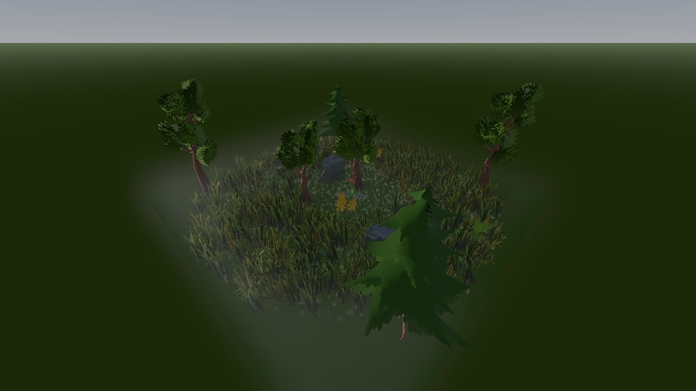

# Critterbug style guide

The world is built from Quaternius's [Stylized Nature MegaKit](https://quaternius.com/packs/stylizednaturemegakit.html)
(`assets/Stylized Nature Megakit/`). Everything we make, from critters and props to UI and effects, should look like it
belongs in that kit. Check new work against this page and against `world-overview.jpg`.

## Palette

Colours sampled from the kit's textures and the world scene.

| Role | Hex | Where it comes from |
|---|---|---|
| Pine | `#335800` | `Leaf_Pine_C.png` |
| Leaf | `#587B00` | `Leaves_NormalTree_C.png` |
| Grass | `#4F9D02` | `Grass.png` |
| Ground | `#3F6000` | World ground material |
| Dry grass | `#9E8109` | `Grass.png` tips |
| Bark | `#8F5B45` | `Bark_NormalTree.png` |
| Bark shade | `#754939` | `Bark_NormalTree.png` |
| Stone | `#5B6259` | `Rocks_Diffuse.png` |
| Moss | `#4A5D25` | `PathRocks_Diffuse.png` |
| Flower red | `#E15648` | `Flowers.png` |
| Petal | `#D3A87E` | `Flowers.png` |
| Mushroom | `#D49C55` | `Mushrooms.png` |
| Cap | `#C3AF96` | `Mushrooms.png` |

- The world is mostly greens and warm browns at mid saturation. Keep large surfaces there.
- Saturated warm colours (flower red, mushroom orange) are accents. Use them small and sparingly, for things the eye
  should find: critters, interactive props, cues.
- Avoid pure black, pure white and cold blues on world objects. Shadows go to dark olive and brown, not grey.

## Shapes

- Chunky, low-poly forms with soft bevels. Silhouettes read at a distance: a tree is a clear trunk and a lumpy crown.
- Proportions are slightly exaggerated: thick trunks, big leaf clusters, oversized mushrooms and flowers.
- Foliage is alpha-cut cards on top of the low-poly volumes. Grass is single-sided blades scattered in clumps.
- No hard-surface detail, sharp bevels or thin greebles. Round off corners.

## Lines and texture density

- No outlines. Edges come from shape and lighting.
- Textures are painted, low-detail colour with soft gradients. Bark has a gentle stroke pattern and a normal map;
  rocks use a mottled diffuse with moss patches. No photographic detail.
- Texel density roughly matches the kit: 1024–2048 px textures for tree- and rock-sized props, 512 px for small
  ones. Share atlases between props where possible, as the kit does.

## Lighting and atmosphere

- One directional sun with shadows and a procedural sky (`src/world/World.tscn`).
- A low, light ground fog (FogVolume, density 0.06) softens the distance. From the 3/4 game camera it must stay
  thin; thick fog washes the scene grey.
- The sky's ground colour is dark olive, so the edge of the world reads as distant ground, not a void.

## Characters and critters

Not designed yet. Player placeholders are simple shapes in P1–P4 colours (release 0.3 plan). When critters and the
troubadours are designed, they follow the shapes and palette above, and each gets one accent colour that reads
against the greens.

## Asset records

Every third-party or AI-generated asset is listed in [`../assets.md`](../assets.md) with its source, licence or model,
and date.
