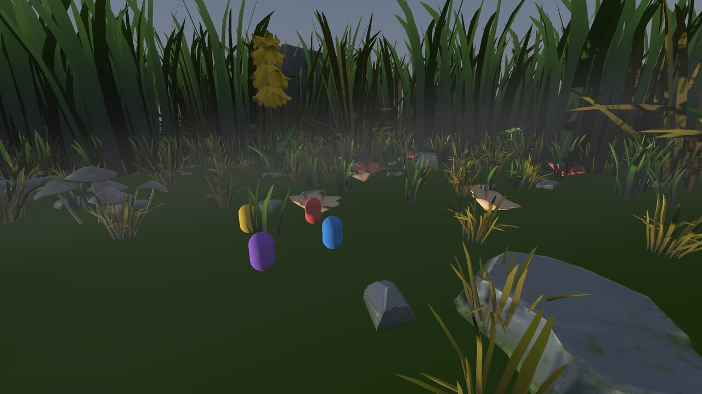
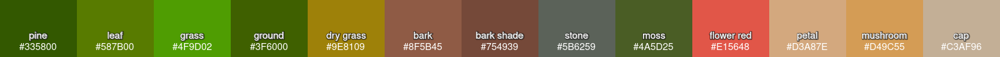

# Critterbug style guide

The world is built from Quaternius's [Stylized Nature MegaKit](https://quaternius.com/packs/stylizednaturemegakit.html)
(`assets/Stylized Nature Megakit/`). Check new work against this page and against `world-bug-scale.jpg`.

> **Provisional.** The Megakit textures are placeholders. A complete art direction and texture overhaul is planned
> (#58). Until then, the palette, shapes and texture density below describe the Megakit so new work doesn't clash
> with it, but don't polish or extend the Megakit look. The **Scale** and **Lighting** rules are about how the
> world reads, and they carry over to the new art.

## Scale

The players are tiny critters in a world of giant grass. One game unit is one metre for physics and movement, and
a character is about **1 unit tall**. The world is scaled up around them; the characters are not shrunk.

- In `src/world/World.tscn`, all nature sits under the `Nature` node, which is scaled **8×**. Inside it, place kit
  props at their kit size; outside it (camera, light, fog, players), work in game units.
- At that scale, compared with a 1-unit character:

| Thing | Kit model and scale inside `Nature` | Height in game units |
|---|---|---|
| Tall grass, the "forest" | `Grass_*_Tall` ×1 | 13–15 |
| Short grass tufts | `Grass_*_Short` ×0.2–0.3 | 2–3.5 |
| Flower, a tree | `Flower_*_Single` ×0.55–0.7 | 10–12 |
| Mushroom | `Mushroom_Common` ×0.6 | 2 |
| Boulder | `Pebble_*` ×1–1.5 | 1–1.5 (3–5 wide) |
| Gravel | `Pebble_*` ×0.35 | 0.3 |
| Stepping stone | `RockPath_*` ×0.7 | 0.6 |
| Fallen petal | `Petal_*` ×0.4 | 0.8 |
| Cliff | `Rock_Medium_*` ×1 | 18 |
| Giant tree (backdrop) | `CommonTree_*` ×1 | 55–60 |

- Pine, twisted and dead trees are 60–150 units at this scale. Use them only as distant backdrops.
- The camera is low and close (about 3–4 units up, 8–10 away), so the grass reads as a forest. Walkable ground is
  a clearing; tall grass is the forest wall around it.
- New critters and props: design them against a 1-unit character, then check them in the world scene beside
  one.

## Palette

Colours sampled from the kit's textures and the world scene. Note that `Plant_7` is violet: use it sparingly.

| Role | Hex | Where it comes from |
|---|---|---|
| Pine | `#335800` | `Leaf_Pine_C.png` |
| Leaf | `#587B00` | `Leaves_NormalTree_C.png` |
| Grass | `#4F9D02` | `Grass.png` |
| Ground | `#3F6000` | World ground material |
| Dry grass | `#9E8109` | `Grass.png` tips |
| Bark | `#8F5B45` | `Bark_NormalTree.png` |
| Bark shade | `#754939` | `Bark_NormalTree.png` |
| Stone | `#5B6259` | `Rocks_Diffuse.png` |
| Moss | `#4A5D25` | `PathRocks_Diffuse.png` |
| Flower red | `#E15648` | `Flowers.png` |
| Petal | `#D3A87E` | `Flowers.png` |
| Mushroom | `#D49C55` | `Mushrooms.png` |
| Cap | `#C3AF96` | `Mushrooms.png` |

- The world is mostly greens and warm browns at mid saturation. Keep large surfaces there.
- Saturated warm colours (flower red, mushroom orange) are accents. Use them small and sparingly, for things the eye
  should find: critters, interactive props, cues.
- Avoid pure black, pure white and cold blues on world objects. Shadows go to dark olive and brown, not grey.

## Shapes

- Chunky, low-poly forms with soft bevels. Silhouettes read at a distance: a tree is a clear trunk and a lumpy crown.
- Proportions are slightly exaggerated: thick trunks, big leaf clusters, oversized mushrooms and flowers.
- Foliage is alpha-cut cards on top of the low-poly volumes. Grass is single-sided blades scattered in clumps.
- No hard-surface detail, sharp bevels or thin greebles. Round off corners.

## Lines and texture density

- No outlines. Edges come from shape and lighting.
- Textures are painted, low-detail colour with soft gradients. Bark has a gentle stroke pattern and a normal map;
  rocks use a mottled diffuse with moss patches. No photographic detail.
- Texel density roughly matches the kit: 1024–2048 px textures for tree- and rock-sized props, 512 px for small
  ones. Share atlases between props where possible, as the kit does.

## Lighting and atmosphere

The goal is that the band and the clearing read clearly from the low 3/4 camera, while the grass wall still feels
like a forest. All values are in `src/world/World.tscn`.

- **Sun:** one directional light, about 45° above the horizon, shining from behind and to the right of the camera
  (from +x, +z toward the origin). Warm white (`#FFEDCC`), energy 1.3, shadows on (2 splits, distance 60; the camera is close, and 4 splits at 200 cost about 20 fps). A sun at or
  below the horizon leaves the ground unlit: keep it high.
- **Shadows** from the giant grass fall across the clearing and give it depth. The band should stand in mixed sun
  and shade, never in a uniformly dark clearing.
- **Ambient:** from the procedural sky, energy 1.0, so shaded sides stay readable.
- **Tonemap:** Filmic. SSAO on, which grounds props and characters where they touch the ground.
- No glow and no extra exposure: both haze the scene and lower the contrast between the band and the grass.
- **Fog:** a low, light ground fog (FogVolume, 8 units high, density 0.02) softens the distance. From the 3/4 game
  camera it must stay thin; thick fog washes the scene grey.
- The sky's ground colour is dark olive, so the edge of the world reads as distant ground, not a void.

## Characters and critters

Not designed yet. Player placeholders are simple shapes in P1–P4 colours (release 0.3 plan). When critters and the
troubadours are designed, they follow the shapes and palette above, and each gets one accent colour that reads
against the greens.

- Critters live in `src/world/critters/`, one scene per critter, with a `StaticBody3D` root, the model as `Model`
  and a collision shape. Models come from Blender scripts kept next to the exported `.glb` in
  `assets/critters/<name>/`, so they can be rebuilt.
- A critter faces +Z in Godot (Blender -Y), so its face shows when it isn't rotated.
- The placeholder snail is 1.74 units tall, so it stands taller than a band member without dwarfing the clearing.
  Its orange shell is its accent colour.

## Asset records

Every third-party or AI-generated asset is listed in [`../assets.md`](../assets.md) with its source, licence or model,
and date.
